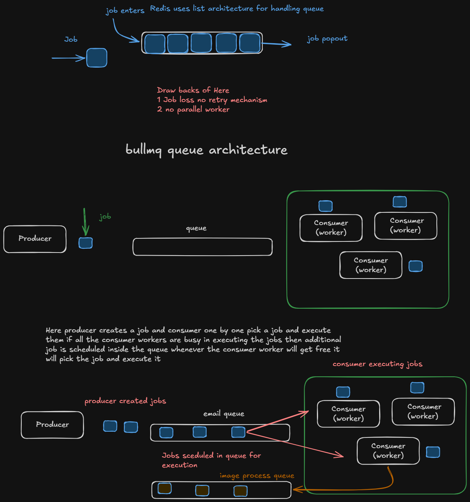

# BullMQ

BullMQ is a package that uses **Redis** internally and provides a **queue** infrastructure. A queue is simply a **data structure** that is stored inside Redis.

## Producer and Consumer

There are two main parts of a queue system:

- **Producer** – Creates and submits jobs to the queue.
- **Consumer (Worker)** – Continuously listens to the queue, picks up jobs, and executes them.

Usually, there are **more consumers (workers) than producers** so multiple jobs can be processed simultaneously.

## Why Producer and Consumer?

If the API does all the work itself:

```text
1000 Reports
      ↓
1000 Heavy Calculations
      ↓
Server Crash
```

With a queue:

```text
1000 Requests
      ↓
1000 Jobs in Queue
      ↓
10 Workers
      ↓
Workers process jobs one by one or in parallel
      ↓
Server stays responsive
```

When the producer creates a job and pushes it into the queue, **only the job-related metadata is stored**, not the actual data.

For example, if a user uploads a video, the **entire video is not pushed into the queue**. Only the required information (such as the file path, user ID, or video ID) is stored, which is later consumed by the worker.

---

# Creating a Queue

Import `Queue` from BullMQ.

First, create a **connection** object that contains the Redis host and port.

Then create a queue using `Queue`. It takes:

1. Queue name
2. Redis connection object

The connection object is simply your Redis connection.

---

# Creating a Worker (Consumer)

After creating the queue, create a **Worker** that processes jobs from the queue.

Import `Worker` from BullMQ.

The `Worker` constructor takes **three arguments**:

1. **Queue name** – The queue from which jobs are picked.
2. **Business logic** – The function that processes the job (sending emails, processing files, generating PDFs, etc.).
3. **Redis connection** – The connection object.

Example responsibilities of a worker:

- Send emails
- Process uploaded files
- Resize images
- Generate reports
- Convert videos

---

# Worker Events

A worker also responds to different events.

Some common events are:

- `completed` – Fired when a job is processed successfully.
- `failed` – Fired when a job fails.
- There are many other events available in the BullMQ documentation.

---

# Creating a Producer

The producer is usually your **API**.

For example, create an endpoint that creates a new job.

Inside the endpoint, call the queue you created (`emailQueue`) using the `add()` method.

The `add()` method takes three arguments:

1. **Job name**
2. **Job data**
3. **Configuration object**

The **job data** usually comes from the request body and contains the information required by the worker.

The **configuration object** can include:

- `attempts` – The number of times BullMQ should retry the job if it fails.
- `backoff` – The retry strategy that determines how long BullMQ should wait before retrying.

For example:

- First failure → Wait **5 seconds**
- Second failure → Wait **10 seconds**
- Third failure → Wait **20 seconds**

This continues until the configured `attempts` limit is reached.

---

# Job Flow

```text
Client
   │
   ▼
Express Route
   │
   ▼
emailQueue.add(...)
   │
   ▼
Redis
   │
   ▼
Queue "emails"
   │
   ▼
Worker notices a new job
   │
   ▼
async (job) => {
    console.log(job.data);
}
   │
   ▼
completed event
```
