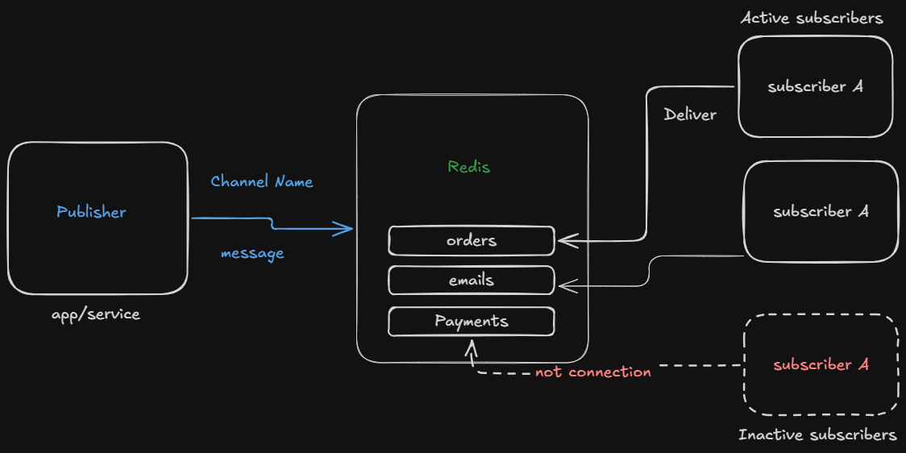

# Publisher Subsciber pub/sub

The pub/sub are mostly used for the notifications. The notification is a broad term in software engineering which often means that to deliver the message. It can be sms, email or a normal notifications all lied or done with this pub/sub model by redis.

# How do we use the redis as pub/sub 

To use the redis as a pub/sub we have to config redis a little bit.

Intermediate

We have channels it can be of order, payments, emails or any other based on the need of the application.

The publishers are the application/service/function/worker which  publishes that require the channel name and the actual message we want to send it can be text or in json format.

The subscribers are divided into active and inactive subscribers continiously listen or look for the channels.

All the subscribers who are active will get update from the appropriate channel and the inactive are not connected then loss the update. 

