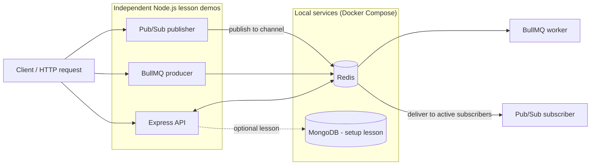
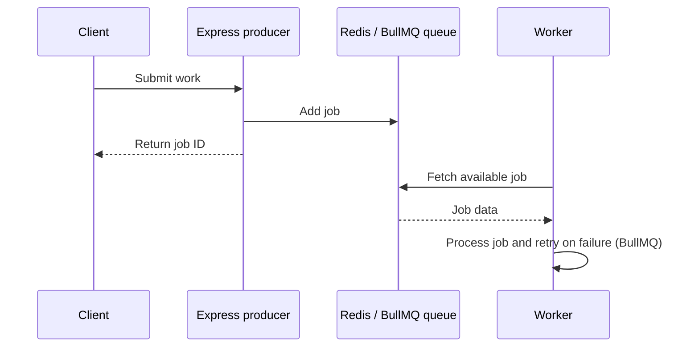

# Learn Redis

A hands-on collection of small Node.js examples for learning Redis concepts and how they fit into common application patterns. Each numbered folder is a separate lesson or demo; this repository is not one application that starts all examples together.

## What you'll learn

| Lesson | Topics |
| --- | --- |
| [01 Foundations Of Redis](<01 Foundations Of Redis/>) | Redis fundamentals |
| [02 Setup Redis Locally](<02 Setup Redis Locally/readme.md>) | Starting Redis and MongoDB locally with Docker Compose |
| [03 Site Banner APIs](<03 Site Banner APIS/readme.md>) | Caching frequently-read site banner data |
| [04 OTP Redis](<04 OTP Redis/readme.md>) | Short-lived OTP values and expiration (TTL) |
| [05 Cache JSON vs Hash](<05 Cache Json VS Hash/readme.md>) | Comparing JSON strings and Redis hashes |
| [06 Redis as Queue](<06 Redis As Queue/readme.md>) | Building a basic list-backed queue and its trade-offs |
| [07 BullMQ](<07 BullMQ/readme.md>) | Redis-backed jobs, producers, workers, and retries |
| [08 Pub/Sub](<08 pub sub/readme.md>) | Publishing messages to Redis channels and subscribing to them |
| [09 More Redis](<09 More Redis/readme.md>) | Counters with `INCR` and ranked data with sorted sets |

## Architecture

The examples are independent Node.js applications that connect to the same local Redis service. The setup lesson also demonstrates MongoDB. Queue workers and Pub/Sub subscribers are separate processes where applicable.



### Queue job flow



The basic list-backed queue in lesson 06 is intentionally simpler and does not provide BullMQ's retry and job-management features. The existing [BullMQ diagram](<assets/bullmq.png>) and [Pub/Sub diagram](<assets/pubsub.png>) provide additional visual examples.

## Requirements

- Node.js and npm (Node.js 18 or newer recommended)
- Docker Desktop or Docker Engine with Docker Compose v2
- A terminal

## Start the local services

From the repository root, start Redis and MongoDB:

```sh
docker compose up -d
```

Check that the services are running and Redis is responding:

```sh
docker compose ps
docker compose exec redis redis-cli ping
```

Redis should reply with `PONG`. Compose publishes Redis on `localhost:6379` and MongoDB on `localhost:27017`. Both services use named Docker volumes so their data persists when containers are stopped.

Stop the services when finished:

```sh
docker compose down
```

This keeps the named volumes. Use `docker compose down -v` only if you intentionally want to delete the persisted Redis and MongoDB data.

## Run a lesson

Each runnable lesson has its own `package.json` and dependencies. Open a terminal, move into the lesson folder, install its dependencies, and start it:

```sh
cd "03 Site Banner APIS"
npm install
npm start
```

Replace the folder name with the lesson you want to run. Keep Docker Compose running while using Redis-backed examples. Start one API demo at a time if they use the same port.

The BullMQ lesson uses separate producer and worker processes. In one terminal:

```sh
cd "07 BullMQ"
npm install
npm start
```

In a second terminal, from the same lesson folder, run:

```sh
node src/worker.js
```

Submit a `POST` request with JSON fields `email` and `name` to `http://localhost:3000/send-welcome-email` to enqueue a job. The worker logs job processing and completion. BullMQ is configured to retry failed jobs up to three attempts with exponential backoff.

For the Pub/Sub lesson, start the API with `npm start` in `08 pub sub`, then start the subscriber in a second terminal:

```sh
cd "08 pub sub"
node src/subscriber.js
```

The subscriber must be running when a message is published; Redis Pub/Sub does not retain messages for disconnected subscribers.

## Configuration

Redis examples connect to `redis://localhost:6379` by default. The MongoDB check defaults to `mongodb://localhost:27017/learn-redis`. Override these values when needed:

```powershell
$env:REDIS_URL = "redis://localhost:6379"
$env:MONGO_URL = "mongodb://localhost:27017/learn-redis"
```

The environment variables apply to processes started from that PowerShell session.

## Troubleshooting

- **Redis connection refused:** Start Compose with `docker compose up -d` and check `docker compose ps`.
- **Address already in use:** Stop the other lesson using that port before starting another API demo.
- **Worker receives no jobs:** Ensure the BullMQ API and worker use the same Redis service and that both processes are running.
- **Pub/Sub subscriber sees no message:** Start the subscriber before sending a notification.

## Repository layout

```text
.
├── 01 Foundations Of Redis/
├── 02 Setup Redis Locally/
├── 03 Site Banner APIS/
├── 04 OTP Redis/
├── 05 Cache Json VS Hash/
├── 06 Redis As Queue/
├── 07 BullMQ/
├── 08 pub sub/
├── 09 More Redis/
├── assets/
└── docker-compose.yml
```

Each lesson's README contains its own notes and examples. The root Compose file defines Redis and MongoDB for local development.

